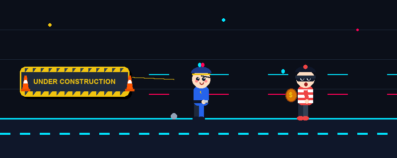
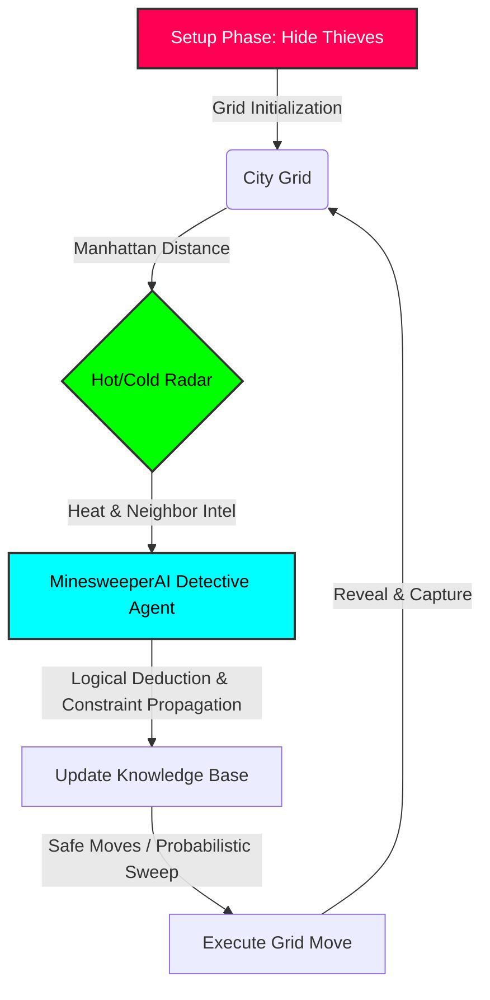

<div align="center">

# 🚨 DIGITAL FUGITIVE 🚨
**[ SYSTEM CLASSIFICATION: ACTIVE PURSUIT ]**

<br>

<!-- Cute Thief, Police & Under Construction GIF Animation -->


<br>

> *"In the grid, there is nowhere to hide. Only paths yet to be calculated."*

<br>

[](https://python.org)
[](https://pygame.org)
[]()

<br>

</div>

---

### 🎨 00. SYSTEM ANIMATION SOURCE CODE

<details>
<summary><b>[ ACCESS CUTE CHASE & UNDER CONSTRUCTION ANIMATION SVG ]</b></summary>
<i>Save the SVG code below as <code>under_construction.svg</code> locally and open it in any web browser to view the cute animated pursuit simulation.</i>

```xml
<svg width="800" height="320" viewBox="0 0 800 320" xmlns="http://www.w3.org/2000/svg">
  <defs>
    <linearGradient id="bg-grad" x1="0%" y1="0%" x2="100%" y2="100%">
      <stop offset="0%" stop-color="#0B0F19"/>
      <stop offset="100%" stop-color="#161F33"/>
    </linearGradient>
    
    <linearGradient id="siren-blue" x1="0%" y1="0%" x2="100%" y2="100%">
      <stop offset="0%" stop-color="#00F0FF" stop-opacity="0.8"/>
      <stop offset="100%" stop-color="#0044FF" stop-opacity="0"/>
    </linearGradient>

    <linearGradient id="siren-red" x1="0%" y1="0%" x2="100%" y2="100%">
      <stop offset="0%" stop-color="#FF0055" stop-opacity="0.8"/>
      <stop offset="100%" stop-color="#FF0000" stop-opacity="0"/>
    </linearGradient>

    <pattern id="caution-stripes" width="20" height="20" patternTransform="rotate(45)" patternUnits="userSpaceOnUse">
      <rect width="10" height="20" fill="#F1C40F"/>
      <rect x="10" width="10" height="20" fill="#2C3E50"/>
    </pattern>

    <filter id="glow-cyan" x="-20%" y="-20%" width="140%" height="140%">
      <feGaussianBlur stdDeviation="4" result="blur" />
      <feComposite in="SourceGraphic" in2="blur" operator="over" />
    </filter>
    <filter id="glow-yellow" x="-20%" y="-20%" width="140%" height="140%">
      <feGaussianBlur stdDeviation="3" result="blur" />
      <feComposite in="SourceGraphic" in2="blur" operator="over" />
    </filter>
  </defs>

  <style>
    .bg-grid { stroke: #1E293B; stroke-width: 1; opacity: 0.5; }
    .road-line { animation: roadScroll 0.5s linear infinite; }

    @keyframes roadScroll {
      0% { transform: translateX(0); }
      100% { transform: translateX(-40px); }
    }

    .thief-group { animation: runnerBob 0.35s ease-in-out infinite alternate; }
    .police-group { animation: runnerBob 0.35s ease-in-out infinite alternate-reverse; }
    .banner-group { animation: bannerWave 1.8s ease-in-out infinite alternate; }

    @keyframes runnerBob {
      0% { transform: translateY(0px) rotate(1deg); }
      100% { transform: translateY(-8px) rotate(-2deg); }
    }

    @keyframes bannerWave {
      0% { transform: translateY(0px) rotate(-1deg); }
      50% { transform: translateY(-5px) rotate(1.5deg); }
      100% { transform: translateY(3px) rotate(-1deg); }
    }

    .leg-back { animation: legRunBack 0.35s ease-in-out infinite alternate; transform-origin: top center; }
    .leg-front { animation: legRunFront 0.35s ease-in-out infinite alternate; transform-origin: top center; }
    .arm-back { animation: armRunBack 0.35s ease-in-out infinite alternate; transform-origin: top center; }
    .arm-front { animation: armRunFront 0.35s ease-in-out infinite alternate; transform-origin: top center; }

    @keyframes legRunFront { 0% { transform: rotate(-35deg); } 100% { transform: rotate(35deg); } }
    @keyframes legRunBack { 0% { transform: rotate(35deg); } 100% { transform: rotate(-35deg); } }
    @keyframes armRunFront { 0% { transform: rotate(40deg); } 100% { transform: rotate(-40deg); } }
    @keyframes armRunBack { 0% { transform: rotate(-40deg); } 100% { transform: rotate(40deg); } }

    .siren-red-flash { animation: flashRed 0.6s infinite alternate; }
    .siren-blue-flash { animation: flashBlue 0.6s infinite alternate-reverse; }

    @keyframes flashRed { 0% { opacity: 0.1; transform: scale(0.8); } 100% { opacity: 0.9; transform: scale(1.3); } }
    @keyframes flashBlue { 0% { opacity: 0.1; transform: scale(0.8); } 100% { opacity: 0.9; transform: scale(1.3); } }

    .sweat-drop { animation: sweatFly 0.7s linear infinite; }
    @keyframes sweatFly { 0% { opacity: 1; transform: translate(0, 0) scale(1); } 100% { opacity: 0; transform: translate(-25px, -15px) scale(0.3); } }

    .speed-line { animation: speedLine 0.4s linear infinite; stroke-dasharray: 10 20; }
    @keyframes speedLine { 0% { stroke-dashoffset: 0; } 100% { stroke-dashoffset: -30; } }

    .dust-puff { animation: dustPuff 0.5s ease-out infinite; }
    @keyframes dustPuff { 0% { opacity: 0.8; transform: scale(0.5) translate(0, 0); } 100% { opacity: 0; transform: scale(1.5) translate(-20px, -10px); } }

    .star-blink { animation: starBlink 1.5s ease-in-out infinite alternate; }
    @keyframes starBlink { 0% { opacity: 0.2; transform: scale(0.8); } 100% { opacity: 1; transform: scale(1.2); } }
  </style>

  <!-- Background -->
  <rect width="100%" height="100%" fill="url(#bg-grad)" rx="16"/>

  <!-- Stars -->
  <g class="star-blink" style="transform-origin: 100px 50px;"><path d="M100 45 L102 49 L107 50 L103 53 L104 58 L100 55 L96 58 L97 53 L93 50 L98 49 Z" fill="#F1C40F" opacity="0.8"/></g>
  <g class="star-blink" style="animation-delay: 0.5s; transform-origin: 450px 40px;"><path d="M450 35 L451.5 38 L455 39 L452.5 41 L453 44.5 L450 42.5 L447 44.5 L447.5 41 L445 39 L448.5 38 Z" fill="#00E5FF" opacity="0.9"/></g>
  <g class="star-blink" style="animation-delay: 1s; transform-origin: 720px 60px;"><path d="M720 55 L722 59 L727 60 L723 63 L724 68 L720 65 L716 68 L717 63 L713 60 L718 59 Z" fill="#FF0055" opacity="0.7"/></g>

  <line x1="0" y1="60" x2="800" y2="60" class="bg-grid"/>
  <line x1="0" y1="120" x2="800" y2="120" class="bg-grid"/>
  <line x1="0" y1="180" x2="800" y2="180" class="bg-grid"/>

  <!-- Ground Road Platform -->
  <rect x="0" y="240" width="800" height="80" fill="#0F172A"/>
  <line x1="0" y1="240" x2="800" y2="240" stroke="#00E5FF" stroke-width="3" filter="url(#glow-cyan)"/>
  
  <g filter="url(#glow-cyan)">
    <g class="road-line">
      <line x1="0" y1="270" x2="840" y2="270" stroke="#00E5FF" stroke-width="4" stroke-dasharray="25 25" opacity="0.6"/>
    </g>
  </g>

  <line x1="100" y1="150" x2="750" y2="150" stroke="#00E5FF" stroke-width="1.5" opacity="0.25" class="speed-line"/>
  <line x1="50" y1="190" x2="780" y2="190" stroke="#FF0055" stroke-width="1.5" opacity="0.2" class="speed-line"/>

  <!-- 01. UNDER CONSTRUCTION BANNER (LEFT / TRAILING) -->
  <g class="banner-group" transform="translate(40, 110)">
    <path d="M 230 65 Q 260 70 290 60" stroke="#F1C40F" stroke-width="2.5" stroke-dasharray="4 4" fill="none" opacity="0.8"/>
    <rect x="15" y="25" width="220" height="60" rx="14" fill="#000" opacity="0.3"/>
    <rect x="10" y="20" width="220" height="60" rx="14" fill="#1E293B" stroke="#F1C40F" stroke-width="3" filter="url(#glow-yellow)"/>
    <rect x="13" y="23" width="214" height="8" rx="4" fill="url(#caution-stripes)"/>
    <rect x="13" y="69" width="214" height="8" rx="4" fill="url(#caution-stripes)"/>
    <g transform="translate(-5, 30)">
      <path d="M 10 30 L 22 30 L 19 8 L 13 8 Z" fill="#FF5500"/>
      <path d="M 12 22 L 20 22 L 18 16 L 14 16 Z" fill="#FFFFFF"/>
      <rect x="7" y="30" width="18" height="4" rx="2" fill="#E65100"/>
    </g>
    <text x="120" y="52" fill="#F1C40F" font-family="'Segoe UI', Roboto, 'Arial Black', sans-serif" font-size="14" font-weight="900" text-anchor="middle" letter-spacing="1">UNDER CONSTRUCTION</text>
    <g transform="translate(210, 30)">
      <path d="M 10 30 L 22 30 L 19 8 L 13 8 Z" fill="#FF5500"/>
      <path d="M 12 22 L 20 22 L 18 16 L 14 16 Z" fill="#FFFFFF"/>
      <rect x="7" y="30" width="18" height="4" rx="2" fill="#E65100"/>
    </g>
    <circle cx="20" cy="22" r="3" fill="#FFF"/>
  </g>

  <!-- 02. CUTE POLICE OFFICER (MIDDLE) -->
  <g transform="translate(360, 130)">
    <circle cx="10" cy="115" r="8" fill="#94A3B8" class="dust-puff"/>
    <circle cx="25" cy="118" r="5" fill="#CBD5E1" class="dust-puff" style="animation-delay: 0.2s;"/>

    <g class="police-group">
      <g class="arm-back" style="transform-origin: 35px 50px;">
        <rect x="30" y="50" width="10" height="22" rx="5" fill="#1E3A8A"/>
        <circle cx="35" cy="74" r="5" fill="#FFDFC4"/>
      </g>
      <g class="leg-back" style="transform-origin: 30px 80px;">
        <rect x="25" y="78" width="11" height="28" rx="5.5" fill="#1E293B"/>
        <ellipse cx="30" cy="108" rx="8" ry="5" fill="#0F172A"/>
      </g>
      <g class="leg-front" style="transform-origin: 42px 80px;">
        <rect x="37" y="78" width="11" height="28" rx="5.5" fill="#2563EB"/>
        <ellipse cx="43" cy="108" rx="8" ry="5" fill="#0F172A"/>
      </g>
      <rect x="22" y="42" width="32" height="40" rx="10" fill="#2563EB"/>
      <rect x="22" y="70" width="32" height="6" fill="#0F172A"/>
      <path d="M 27 73 L 29 70 L 31 73 L 29 75 Z" fill="#F1C40F"/>
      <circle cx="38" cy="52" r="4" fill="#F1C40F"/>
      <g class="arm-front" style="transform-origin: 40px 50px;">
        <rect x="36" y="50" width="10" height="24" rx="5" fill="#2563EB"/>
        <circle cx="41" cy="76" r="5.5" fill="#FFDFC4"/>
        <rect x="42" y="73" width="8" height="4" rx="1" fill="#CBD5E1"/>
      </g>
      <circle cx="38" cy="28" r="18" fill="#FFDFC4"/>
      <circle cx="44" cy="26" r="3.5" fill="#0F172A"/>
      <circle cx="45.5" cy="24.5" r="1.2" fill="#FFFFFF"/>
      <circle cx="34" cy="26" r="3.5" fill="#0F172A"/>
      <circle cx="35.5" cy="24.5" r="1.2" fill="#FFFFFF"/>
      <ellipse cx="47" cy="31" rx="2.5" ry="1.5" fill="#FF8A8A" opacity="0.6"/>
      <ellipse cx="31" cy="31" rx="2.5" ry="1.5" fill="#FF8A8A" opacity="0.6"/>
      <path d="M 37 32 Q 41 37 44 32 Z" fill="#991B1B"/>
      <path d="M 18 20 C 18 8, 58 8, 58 20 Z" fill="#1E3A8A"/>
      <path d="M 32 20 Q 52 20 56 24 L 32 24 Z" fill="#0F172A"/>
      <rect x="20" y="17" width="36" height="3" fill="#F1C40F"/>
      <circle cx="38" cy="14" r="3" fill="#F1C40F"/>
      <g transform="translate(33, -4)">
        <rect x="0" y="8" width="10" height="4" fill="#475569" rx="1"/>
        <circle cx="2" cy="5" r="14" fill="url(#siren-red)" class="siren-red-flash"/>
        <rect x="1" y="2" width="4" height="6" fill="#FF0055" rx="2"/>
        <circle cx="8" cy="5" r="14" fill="url(#siren-blue)" class="siren-blue-flash"/>
        <rect x="5" y="2" width="4" height="6" fill="#00E5FF" rx="2"/>
      </g>
    </g>
  </g>

  <!-- 03. CUTE THIEF AGENT (RIGHT / FRONT) -->
  <g transform="translate(580, 125)">
    <circle cx="10" cy="120" r="7" fill="#94A3B8" class="dust-puff" style="animation-delay: 0.15s;"/>

    <g class="thief-group">
      <path d="M 15 15 Q 10 10 12 5 Q 17 10 15 15 Z" fill="#00E5FF" class="sweat-drop"/>
      <path d="M 10 25 Q 5 20 7 15 Q 12 20 10 25 Z" fill="#00E5FF" class="sweat-drop" style="animation-delay: 0.3s;"/>
      <g class="arm-back" style="transform-origin: 35px 50px;">
        <rect x="30" y="50" width="10" height="22" rx="5" fill="#991B1B"/>
        <circle cx="35" cy="74" r="5" fill="#FFDFC4"/>
      </g>
      <g class="leg-back" style="transform-origin: 30px 80px;">
        <rect x="25" y="78" width="11" height="28" rx="5.5" fill="#1E293B"/>
        <ellipse cx="30" cy="108" rx="8" ry="5" fill="#EF4444"/>
      </g>
      <g class="leg-front" style="transform-origin: 42px 80px;">
        <rect x="37" y="78" width="11" height="28" rx="5.5" fill="#334155"/>
        <ellipse cx="43" cy="108" rx="8" ry="5" fill="#EF4444"/>
      </g>
      <rect x="22" y="42" width="32" height="40" rx="10" fill="#EF4444"/>
      <rect x="22" y="48" width="32" height="5" fill="#FFFFFF"/>
      <rect x="22" y="58" width="32" height="5" fill="#FFFFFF"/>
      <rect x="22" y="68" width="32" height="5" fill="#FFFFFF"/>
      <g transform="translate(2, 45)">
        <path d="M 0 15 C -5 0, -25 10, -20 25 C -15 40, 5 35, 0 15 Z" fill="#D97706" stroke="#92400E" stroke-width="1.5"/>
        <text x="-10" y="24" fill="#F1C40F" font-family="'Arial Black', sans-serif" font-size="12" font-weight="bold">$</text>
      </g>
      <g class="arm-front" style="transform-origin: 40px 50px;">
        <rect x="36" y="50" width="10" height="24" rx="5" fill="#EF4444"/>
        <circle cx="41" cy="76" r="5.5" fill="#FFDFC4"/>
      </g>
      <circle cx="38" cy="28" r="18" fill="#FFDFC4"/>
      <path d="M 20 23 Q 38 18 56 23 Q 56 31 38 31 Q 20 31 20 23 Z" fill="#0F172A"/>
      <circle cx="44" cy="26" r="3.8" fill="#FFFFFF"/>
      <circle cx="45" cy="26" r="2" fill="#0F172A"/>
      <circle cx="46" cy="25" r="0.8" fill="#FFFFFF"/>
      <circle cx="34" cy="26" r="3.8" fill="#FFFFFF"/>
      <circle cx="35" cy="26" r="2" fill="#0F172A"/>
      <circle cx="36" cy="25" r="0.8" fill="#FFFFFF"/>
      <path d="M 20 22 C 20 10, 56 10, 56 22 Z" fill="#0F172A"/>
      <rect x="18" y="20" width="40" height="4" rx="2" fill="#1E293B"/>
      <circle cx="38" cy="9" r="4" fill="#EF4444"/>
      <ellipse cx="42" cy="34" rx="2.5" ry="3.5" fill="#991B1B"/>
    </g>
  </g>
</svg>
```
</details>

---

## 📡 01. MISSION BRIEFING

**Digital Fugitive** is a high-octane AI simulation engineered to visualize search paradigms, logical constraint propagation, and autonomous agent reasoning. Operating within a constrained digital grid, intelligent **Detective Police Agents** utilize mathematical deduction and hot/cold radar feedback loops to locate and corner hidden **Fugitives (Thieves)**.

It is an exploration of probabilistic reasoning, subset-based logical inference, real-time pathfinding, and algorithmic efficiency.

---

## 🧠 02. SYSTEM ARCHITECTURE (AI LOGIC)

The pursuit operates on a continuous feedback loop between the hunters, the environment, and a knowledge engine.



### 🔬 Core Deductive Engine (`src/agent.py` & `src/brain.py`)
- **Propositional Logical Sentences**: Represents clues as set equations: `{House_A, House_B, House_C} = Count`.
- **Constraint Propagation (Set Difference Inference)**: When one set of unrevealed cells $S_2$ is a subset of another $S_1$ ($S_2 \subseteq S_1$), the system infers:
  $$(S_1 \setminus S_2) = (\text{Count}_1 - \text{Count}_2)$$
- **Safe Move Priority**: Checks guaranteed safe cells derived from logical deductions before resorting to random probabilistic exploration.

---

## ⚙️ 03. TACTICAL CAPABILITIES

### 🔵 The Hunters (Detective AI)
- **Logical Constraint Propagation:** Solves spatial puzzles by inferring safe coordinates and identifying thief hideouts using set-difference arithmetic.
- **Probabilistic Fallback Sweeping:** When no guaranteed safe moves exist, the agent evaluates remaining unvisited coordinates to maintain active search momentum.
- **Hot/Cold Radar Tracking:** Real-time visual feedback reflecting proximity to target heat signatures.

### 🔴 The Hunted (Fugitives)
- **Strategic Traps:** Placed during Phase 1 across the $16 \times 16$ grid matrix.
- **Neighborhood Intel:** Calculates adjacent thief density to feed intelligence back into the AI agent's inference engine.

### 🌡️ Hot & Cold Radar System
The grid dynamically evaluates Manhattan distance $d = |x_1 - x_2| + |y_1 - y_2|$ to the nearest fugitive:
- 🔴 **Hot (`#FF6464`)**: Distance $\le 2$ (Immediate vicinity!)
- 🟡 **Warm (`#FFC864`)**: Distance $\le 4$ (Getting closer)
- 🩵 **Cold (`#96DCFF`)**: Distance $\le 6$ (Moderate range)
- 🔵 **Frozen (`#5082C8`)**: Distance $> 6$ (Target out of perimeter)

---

## 📁 04. PROJECT STRUCTURE

```text
Digital-Fugitive/
├── assets/
│   ├── audio/
│   │   └── background_siren.wav      # Atmospheric background audio
│   └── images/
│       ├── under_construction.gif    # Animated GIF: Thief, Police & Under Construction
│       ├── under_construction.svg    # Vector SVG animation source
│       ├── police_bg.jpg             # Dynamic tactical background
│       ├── thief.png                 # Fugitive entity icon
│       ├── police.png                # Detective unit icon
│       └── jail.png                  # Apprehended target icon
├── src/
│   ├── agent.py                      # MinesweeperAI reasoning agent
│   ├── brain.py                      # Logical Sentence data structure & subset inference
│   ├── city.py                       # CityGrid representation & Hot/Cold color math
│   ├── config.py                     # Grid dimensions, color constants & settings
│   └── main.py                       # Pygame application loop & renderer
├── requirements.txt                  # Project dependencies (Pygame)
└── README.md                         # Project documentation
```

---

## 💻 05. DEPLOYMENT PROTOCOL

### ENVIRONMENT SETUP

```bash
# 1. Clone the repository
git clone https://github.com/sooriya-moorthy-0107/Digital-Fugitive.git

# 2. Access the directory
cd Digital-Fugitive

# 3. Initialize virtual environment (Recommended)
python -m venv venv

# Windows
venv\Scripts\activate
# macOS/Linux
source venv/bin/activate

# 4. Install dependencies
pip install -r requirements.txt

# 5. Execute simulation
python src/main.py
```

---

## 🎮 06. SIMULATION CONTROLS

1. **PHASE 1: SET TRAPS**
   - Click anywhere on the grid to hide fugitive targets (Thieves).
   - Press **`ENTER`** to lock in target locations and activate the AI Police Radar.
2. **PHASE 2: RADAR TRACKING**
   - Watch the Detective AI agent process clues, propagate constraints, calculate radar thermal responses, and systematically corner all fugitives.

---

## 🗄️ 07. AUTHORIZATION & CREDENTIALS

- **Lead Architect:** Sooriya Moorthy
- **Affiliation:** Integrated M.Tech Software Engineering, VIT Vellore
- **GitHub Profile:** [@sooriya-moorthy-0107](https://github.com/sooriya-moorthy-0107)

---

<div align="center">
<i>If this simulation assisted your research, acknowledge by starring (⭐) the repository.</i>
</div>
